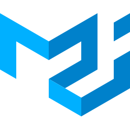
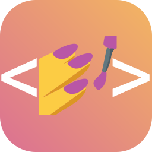

---

<!-- 
 -->

<!-- Title -->
<h3 align="center">
  Frontend Enginear · React.js & Next.js 
</h3>

<samp>
「   Building scalable web applications, interactive maps, and high-performance frontend experiences. 」
</samp>

<a href="https://mojtabapourkhanlar.ir/"><picture><source media="(prefers-color-scheme: dark)" srcset="assets/l-site.svg"></picture></a>
<a href="https://www.linkedin.com/in/mojtaba-pourkhanlar-778370251/"><picture><source media="(prefers-color-scheme: dark)" srcset="assets/l-linkedin.svg"></picture></a>

### 🧰 Tech Stack

|                         |                                                                                                                                                                                                                                                                                                                                                                                                                                                                                                                                                                                                             |
| ----------------------- | ----------------------------------------------------------------------------------------------------------------------------------------------------------------------------------------------------------------------------------------------------------------------------------------------------------------------------------------------------------------------------------------------------------------------------------------------------------------------------------------------------------------------------------------------------------------------------------------------------------- |
| Core Frontend           | 
&nbsp;&nbsp;&nbsp;&nbsp;
                                           |
| State & Data Management | 
&nbsp;&nbsp;
                                                                                                                                                                                                                         |
| UI & Styling            | 
&nbsp;&nbsp;&nbsp;&nbsp;
 |
| GIS, Maps & 3D          | 
&nbsp;&nbsp;&nbsp;
                                                                                                                                        |
| Engineering & Tools     | 
&nbsp;&nbsp;&nbsp;&nbsp;
                                                                           |

<!--  -->

<!-- 

  

 -->

<!--  -->
